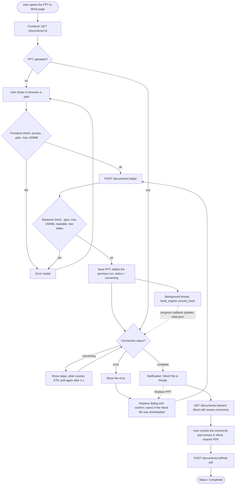
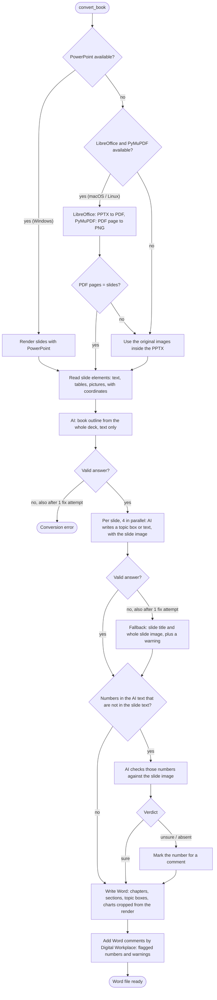

# dwp-ppt-word

Proof of concept: **PPT to Word Convert** for Digital Workplace (DWP).

A Bank Indonesia RDG deck (PowerPoint) is turned into a condensed Word **book** by AI (Claude on Amazon Bedrock). The Word file has review comments by "Digital Workplace" on the parts a person should check. The page for it lives inside the real DWP frontend (a copy of `new-dwp`), following the Sprint 18 design.

```
frontend/  (DWP, Vue 3 + Vuetify)          backend/  (Flask, Python)
/app/v2/ppt-to-word  ── /poc-api/* ──────▶  app.py ─▶ book_engine ─▶ Word (.docx)
                        (dev proxy)                    Claude on Bedrock
```

## Layout

| Path | Purpose |
|---|---|
| `backend/app.py` | POC API: upload / replace PPT, conversion progress, Word download, final PDF |
| `backend/book_engine.py` | Full AI conversion: outline, per-slide writing, number check; CLI |
| `backend/book_writer.py` | Book format for Word and HTML |
| `backend/slide_reader.py` | Reads slide elements with coordinates; renders slides (PowerPoint or LibreOffice) |
| `backend/llm.py`, `backend/bedrock_llm.py` | LLM calls (Bedrock; Ollama optional) |
| `backend/docx_common.py` | Shared Word helpers: template, styles, review comments |
| `backend/templates/` | Word template |
| `backend/tests/` | Tests (no real LLM calls) |
| `frontend/` | Copy of the DWP frontend (`new-dwp`) with the POC page and POC mode |
| `samples/` | Sample decks and the example books the format follows |

## Setup

Backend (Python 3.13; only once, on a fresh checkout):

```
py -3.13 -m venv .venv
.venv\Scripts\pip install -r backend\requirements.txt
copy backend\.env.example backend\.env      # then fill in AWS_BEARER_TOKEN_BEDROCK
```

Do not run `python -m venv .venv` over an existing `.venv` with another Python version: the installed packages are built for 3.13 and stop loading (`cannot import name 'etree' from 'lxml'`). To rebuild it, use `py -3.13 -m venv --clear .venv` and install the requirements again.

Frontend (Node 18+). It also needs `frontend/.env.development` from the DWP team (not in git); `.env.poc` only overrides a few values.

```
cd frontend
npm install
```

Slide renders use Microsoft PowerPoint on Windows, or LibreOffice (`soffice`) plus PyMuPDF elsewhere. Without either, the original images in the PPTX are used.

## Run

```
python backend/app.py                                  # API on http://localhost:5003
npm --prefix frontend run serve-poc -- --port 8090    # http://localhost:8090/app/v2/ppt-to-word
```

Both are also in `.claude/launch.json` (`backend`, `frontend`). POC mode skips DWP's SSO, answers DWP middleware calls with mock data, and proxies `/poc-api/*` to the backend. See [frontend/src/v2/poc/README.md](frontend/src/v2/poc/README.md).

## Flow

### Page and API

What happens from the page to the Word file (`frontend/src/v2/views/poc/PptToWordView.vue` and `backend/app.py`).



### Conversion engine

`book_engine.convert_book`, which runs in the background thread above.



Every AI call (outline, per slide, number check) looks in `backend/work/book_cache` first. The answer is validated (JSON shape, slide numbers and element ids that exist on the slide, required fields, figure and caption limits), and an invalid answer gets one fix attempt with the errors sent back to the AI.

## How the conversion works

`book_engine.convert_book` (also a CLI):

1. **Render**: every slide is rendered to PNG, with PowerPoint on Windows or LibreOffice + PyMuPDF on macOS / Linux. With neither, the original images in the PPTX are used.
2. **Outline**: one text-only AI call over the whole deck picks the book title, chapters and sections, and which slides go where. Each slide becomes a `topic` box (key message, chart cropped from the render, bullets) or near-verbatim `text`. Cover, agenda, dividers and appendix are left out.
3. **Per slide**: one AI call with the slide render and its elements. The AI only names which elements form the chart area; images are cropped from the render, so charts are never redrawn.
4. **Number check**: numbers in the AI text that are not in the slide text are checked against the slide image. Uncertain numbers get a Word comment by "Digital Workplace".

```
python backend/book_engine.py "samples/rdgb-maret-2026/DKEM RDGB Maret 2026_06_Materi Hari Kedua_afterRDG.pptx" -o backend/work/buku.docx
```

AI answers are cached in `backend/work/book_cache`, so re-runs only call the AI for changed slides. The model is `BEDROCK_MODEL` in `backend/.env`.

## API

- `GET /api/poc/documents/<id>`: PPT, conversion progress (steps, slide counter, AI slide counter, ETA), Word and final PDF.
- `POST /api/poc/documents/<id>/ppt` (multipart `file`): upload or replace the PPT (`.pptx`, max 150MB) and start converting. A replaced PPT and its Word file are deleted.
- `GET /api/poc/documents/<id>/word`: the Word file with review comments.
- `POST /api/poc/documents/<id>/final-pdf` (multipart `file`): the final PDF, after the Word file exists.
- `POST /api/poc/documents/<id>/reset`: clear everything (demo).

State is kept in `backend/work/poc/<id>/state.json`, so it survives a restart. A conversion that was running when the server stopped is marked failed.

## Tests

```
python -m unittest discover backend/tests
```

The older experiments (rules-based report engine, `/dwp` editor, PowerPoint add-in, YOLO layout models) were removed from this branch; they remain in git history.
